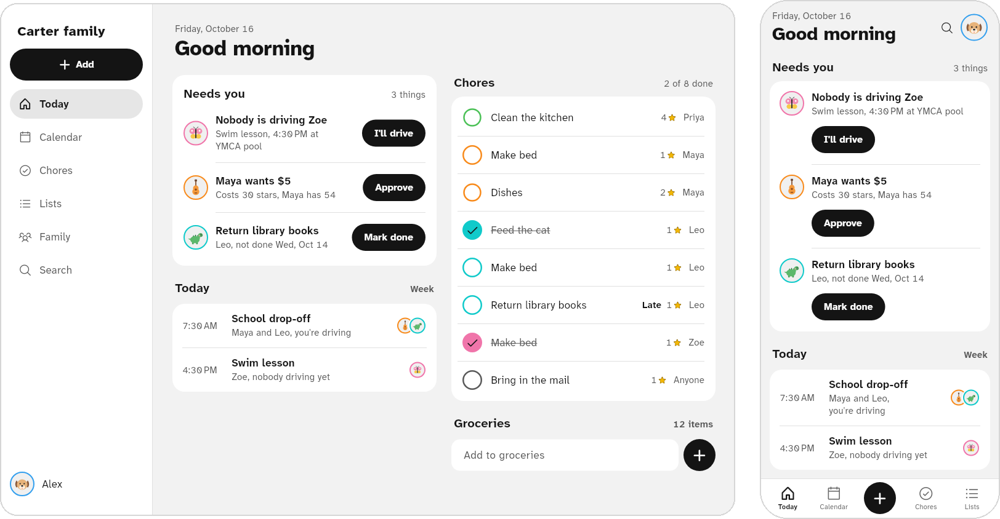

# Den

The family's calendar, chores, lists and points, in one app on everyone's phone.



Den runs on a computer you own, not on someone else's service, and only your family's devices can
reach it. Setting it up takes one pasted line and a few taps.

- [Quick start](#quick-start)
- [On a NAS or any Docker box](#on-a-nas-or-any-docker-box)
- [Reaching Den from away](#reaching-den-from-away)
- [Backups, and your NAS](#backups-and-your-nas)
- [Updates](#updates)
- [Moving Den to another computer](#moving-den-to-another-computer)
- [If something goes wrong](#if-something-goes-wrong)

## Quick start

1. **On a Linux computer that stays on** (an old PC, a mini PC, a Raspberry Pi 4 or 5, or a VPS,
   with at least 1 GB of memory), open a terminal, paste this line and press Enter:

   ```sh
   curl -fsSL https://github.com/xattribution/Den/releases/latest/download/install.sh | sudo sh
   ```

   It installs everything Den needs into `~/den` and ends with a link and a square code.

2. **Open that link** on your phone or a computer on the same Wi-Fi (or anywhere, with Tailscale
   on). Or point your phone's camera at the square code.

3. **Den's setup page takes it from there:** make your family, add your NAS for backups, and
   invite everyone. Nothing else is typed into a terminal.

**Who can reach it.** On your home Wi-Fi and your tailnet, Den works like any home device: the
first person to open its setup page sets it up. From anywhere else, Den answers only your family's
devices, and a phone that opens an invite you sent. Everyone else gets nothing at all, not even a
login page.

**On an iPhone:** when Den opens in Safari, tap **Share**, then **Add to Home Screen**, then
**Add**. On Android: Chrome's **⋮** menu, then **Install app**.

**Save your recovery words.** They're 12 words that get you back in if you lose your phone, and
they open your backups. In Den: your picture, then **Family**, your name, **Recovery words**.

## On a NAS or any Docker box

Synology, Unraid, TrueNAS, Portainer and the like: add a container from
`ghcr.io/xattribution/den:stable`, with port `47733` and a volume at `/data`. Or with Docker:

```sh
docker run -d --name den --restart unless-stopped -p 47733:47733 -v den-data:/data ghcr.io/xattribution/den:stable
```

Then open `http://<the box's address>:47733` on the home Wi-Fi. Den's setup page takes it from
there.

## Reaching Den from away

**With Tailscale:** if the computer running Den has Tailscale, the installer puts Den on your
tailnet by itself, at `https://<computer>.<tailnet>.ts.net` with a real certificate. Every phone
with Tailscale on reaches it from anywhere and counts as home. (If the installer says so, turn on
**HTTPS Certificates** on the DNS page of Tailscale's admin console once, then run `sudo den`.)

**With Cloudflare,** for family who won't install Tailscale: Den's setup page (Settings, Advanced,
Server, on a parent's phone later) takes a Cloudflare Tunnel's token. The tunnel only carries the
family's devices to Den; nobody else gets anything through it. You need a free Cloudflare account
and a domain on it.

### Making the Cloudflare Tunnel


Here you make a **tunnel**: a private line from your computer to Cloudflare. You'll come away with
a long code called a **tunnel token**.

1. Sign in at [dash.cloudflare.com](https://dash.cloudflare.com).
2. In the menu on the left, open **Networking**, then **Tunnels**.
   (On some accounts it's under **Zero Trust**, then **Networks**, then **Tunnels**.)
3. Click **Create Tunnel**. If it asks what kind, pick **Cloudflared**.
4. Give it a name, like `den`, and click **Create Tunnel** (or **Save tunnel**).
5. Cloudflare now shows some commands to install something. **Don't run them.** Den does that
   part itself. Just copy one of the commands: click the copy button next to it.

   The command has your tunnel token in it: a long code starting with `eyJ`. You can paste the
   whole command into Den's setup page; Den finds the token in it.

   Keep this page open: you come back to it below.

**Keep the token private.** Anyone with it can pretend to be your Den. If it ever gets out, delete
the tunnel in Cloudflare and make a new one.

### Giving Den its address in Cloudflare

Back on the Cloudflare page from above:

1. Click **Continue** (or **Next**). If you closed the page: **Networking**, then **Tunnels**,
   then click your tunnel's name.
2. Find **Routes** (or **Public hostnames**) and click **Add route** (or **Add a public
   hostname**). If it asks what kind, pick **Published application**.
3. Fill it in:
   - **Subdomain:** `den`
   - **Domain:** pick your domain from the list
   - **Service URL:** `http://hub:47733`

     If the page has two boxes instead, set **Type** to `HTTP` and **URL** to `hub:47733`.
4. Click **Add route** (or **Save**).

Type it exactly as shown: `hub`, not `localhost` and not your computer's address.

That's your family's address: `den.` plus your domain, like `den.smithfamily.com`.

## Backups, and your NAS

Den backs up your family **every night** on its own, and keeps the newest 14. You don't need to do
anything. Any parent's **recovery words** open a backup. If no parent has saved recovery words,
Den can't make backups, and Settings, **Backups** says so.

**To also keep a copy on a NAS at home** (a Synology, QNAP or similar):

1. On the NAS, make sure **file sharing (SMB)** is on, and make a shared folder for backups if you
   don't have one. Your NAS's own settings have both.
2. In Den on your phone: **Settings**, **Backups**, **Back up to a NAS**.
3. Type your NAS's name or address (like `nas.local` or `192.168.1.20`), then a username and
   password for the NAS.
4. Pick the shared folder. Den makes a test copy, and if that works, it saves.

From then on, every night's backup goes to the NAS too. If the NAS can't be reached, Den tells you
once, and the server still keeps its own copy.

**Back up now:** Settings, **Backups**, **Back up now**.

## Updates

Den updates itself at night. If an update doesn't start properly, Den goes back to the version
before, by itself. When there's an update, Den shows it in **Settings**, **Advanced**,
**Server**, with an **Update now** button.

## Moving Den to another computer

1. Run the [quick start](#quick-start) line on the new computer, and give it the **same tunnel token**.
2. Open the link it shows and choose **Restore from a backup**.
3. Pick where the backup is: **A file on this device**, **On your NAS**, or **On this server**.
   Pick the backup (the newest is already chosen) and type your recovery words.
4. Turn off the old computer, or uninstall Den there: `sudo den uninstall`.

Everyone's phones find the family again on their own, because the address stays the same.

## If something goes wrong

**First, try this:** run the install line from the quick start again. It's safe to run as many times as
you want. It fixes what it can and never deletes your family.

To see how Den is doing, type this in the terminal:

```sh
sudo den status
```

**"curl: command not found"** (or **"sudo: command not found"**). Your computer is missing a basic
tool. On Debian or Ubuntu, type `apt-get install -y curl sudo` and press Enter (as `root`), then try
again.

**"Den needs to be installed as the computer's administrator."** You left out `sudo`. Copy the
whole line from the quick start again, including `| sudo sh` at the end.

**"This Raspberry Pi is running the 32-bit Raspberry Pi OS"**, or **"Den needs 64-bit"**. Den only
runs on 64-bit systems. Put the 64-bit system on the computer (for a Raspberry Pi, use Raspberry
Pi Imager and pick **Raspberry Pi OS (64-bit)**), then start again from the quick start.

**"This computer has ... memory"** or **"... free disk space"**. The computer is too small. Den
needs 1 GB of memory and 2 GB of free space. On a VPS, pick a bigger plan.

**"Den's download isn't available right now"**. Den's download site turned the computer away.
That's on Den's side, not yours: wait a while and run the line again. If it keeps happening,
report it on Den's GitHub page.

**"Couldn't reach download.docker.com"**, **"Couldn't download Den"** or **"Couldn't reach this
computer's software sources"**. The computer isn't getting to the internet. Check its connection,
wait a few minutes, and run the line again.

**"Something else on this computer already uses port 47733"**. Something else, often an older
Den, is in the way. If you set up an older Den by hand, stop it first, then run the line again.

**"This computer has Podman"**. Den needs Docker, and this computer has a look-alike. It's
simplest to use a fresh computer or VPS.

**"That doesn't look like a tunnel token"**. Copy the command from Cloudflare again ([Making the Cloudflare Tunnel](#making-the-cloudflare-tunnel), number
5) and paste the whole thing. To give Den the token later: `sudo den tunnel`.

**The tunnel says it didn't connect.** Check the token: make a new one in Cloudflare if you're not
sure, then `sudo den tunnel` and paste it.

**Den's address shows a Cloudflare error page** (like "Bad gateway" or error 1033).
- Check [Giving Den its address in Cloudflare](#giving-den-its-address-in-cloudflare): the Service URL must be exactly `http://hub:47733`.
- Run `sudo den status`. If it says Den isn't running, run the install line again.

**The setup link doesn't open.** It works only once. Make a new one: `sudo den setup-link`.

**Den's address shows a blank page away from home.** That's Den keeping strangers out. A new phone
gets in by opening an invite a parent sent (or by being on the home Wi-Fi or Tailscale). A phone
already in the family opens Den from its Home Screen icon as usual.

**The NAS can't be found.** Type its address as numbers (like `192.168.1.20`) instead of its name.
You'll find the address in your router's list of devices, or in the NAS's own settings. Den
needs to be on the same home network as the NAS, so a VPS can't back up to a NAS at home.

**Starting over.** `sudo den reset` deletes everything Den keeps on this computer and starts
fresh. The family's phones keep their own copy. It asks you to type `RESET` first.

**Removing Den.** `sudo den uninstall`.

Still stuck? Run `sudo den logs`, copy what it shows, and send it to whoever helps you with
computers.

## Optional extras

- **Sign in with Google.** Parents can also sign in to Den in a web browser with their Google
  account. In Den on your phone: **Settings**, **Advanced**, **Sign in with Google or Apple**. The
  screen walks you through it. Apple sign-in needs a paid Apple developer account, so most
  families skip it.
- **The AI helper**, which can add things from a photo of a flyer or a sentence like "soccer every
  Wednesday at 5 for Leo": **Settings**, **AI helper**. It's off until a parent turns it on.

## For the technical folks

How it works, other ways to run it and how to build it:
[docs/technical.md](docs/technical.md) and [docs/install-technical.md](docs/install-technical.md).

## License

AGPL-3.0 for the app, hub and relay; MIT for `den_core`.
