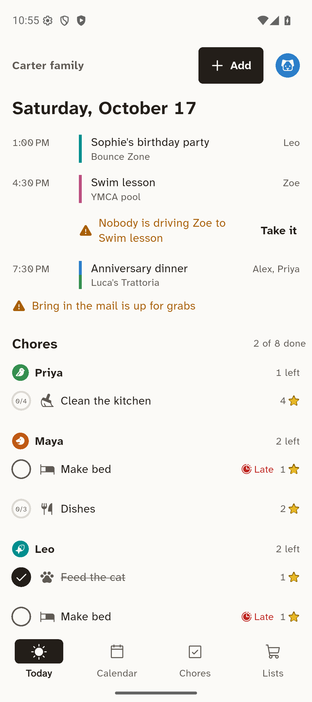

# Den

The family's calendar, chores, lists and points, on the family's own devices.



## Quick start

**Just phones.** Install Den on one parent's phone, tap "Start a family", add the kids, and
invite your partner from Family → Devices → Add a device (a QR code, or four words to read out).
Every phone keeps the whole family, encrypted, and phones sync with each other when they meet on
the same Wi-Fi. Nothing to host.

**With a hub (recommended).** An always-on device keeps the family online while phones sleep and
runs the extras: Home Assistant, AI access over MCP, calendar feeds, reminders.

- An old Android tablet or a computer: install Den and turn on Settings → This device →
  "Keep the family online". The hub runs inside the app.
- A NAS, mini PC or Raspberry Pi with Docker:

  ```bash
  docker run -d --name den-hub --restart unless-stopped --network host \
    -v den-hub:/data ghcr.io/xattribution/den-hub:latest
  ```

  The hub prints a setup code in its log (`docker logs den-hub`). On a parent's phone, go to
  Family → Devices → Add a device → A hub, pick it from the list or type its address, and enter
  the code. Any browser can then open `http://<hub-address>:47733` and link itself by showing a
  QR code for a parent's phone to scan.

**Away from home.** Phones reach the hub through a relay that only ever carries encrypted data.
Run your own with `deploy/relay`, then enter its address under Settings → This device → Relay.

**Moving from Sett.** `den_hub import-sett coord.db --as <your name>` brings members, events with
their exceptions, chores with steps and check-offs, lists, goals and point adjustments into the
hub's family.

## What's here

| Path | What |
| --- | --- |
| `app/` | The Flutter app for iPhone, iPad, Android, Mac, Windows, Linux and the web |
| `packages/den_core/` | The engine: data model, signed change log, spaces, permissions, recurrence, chores, points, history |
| `packages/den_net/` | Encrypted sessions, sync, pairing, key rotation, relay client, encrypted backups |
| `packages/den_hub/` | The hub library: HTTP API, MCP with OAuth, Home Assistant bridge, reminders, calendar feeds, mDNS |
| `packages/den_hub_cli/` | The `den_hub` command: serve, MCP over stdio, Sett import, backup and restore |
| `packages/den_relay/` | The relay: tunnel, mailbox and pairing rendezvous |
| `packages/den_sett_import/` | Reads Sett's `coord.db` |
| `integrations/homeassistant/` | The Home Assistant integration (calendars, to-do lists, sensors, services, events) |
| `deploy/` | Docker images for the hub and the relay |
| `DESIGN.md` | The design system every screen follows |
| `ARCHITECTURE.md` | The contract every package builds against |
| `docs/hub-api.md` | The hub's REST, stream and mDNS contract |

## Status

| Part | Tests | Verified on this machine |
| --- | --- | --- |
| Engine (`den_core`) | 170 | Analyzer clean |
| Networking (`den_net`) | 68 | Two and three devices syncing in memory, over WebSocket and through the relay |
| Relay | 20 | Tunnel, mailbox, rendezvous, rate limits |
| Hub and its command line | 48 + 5 | Compiled binary serves the web app and prints its setup code |
| Sett importer | 8 | A Sett schema v12 fixture |
| App | 223, with 157 screenshots | Release APK on an Android emulator; web build in a browser |
| Home Assistant integration | 74 | Home Assistant 2026.2 test harness; 30 of 30 contract checks against a live hub |

Windows, macOS, iOS and Linux app builds and the Docker images run in CI (`.github/workflows`).

Known gaps: phones refresh reminders in the background about hourly, but desktops only while Den
runs, and iOS can't read the device's keys while the phone is locked, so its background refresh
waits for an unlocked moment; browsers get no reminders; the Home Assistant integration needs its own repository root to install through HACS;
Android needs a foreground service to keep an in-app hub running in the background; the hub
doesn't yet show the matching words while it waits to be approved; when two parents revoke
devices at the same moment while out of touch, their rotated keys can briefly diverge.

## Develop

Requirements: Flutter 3.38 (includes Dart 3.10).

```bash
cd packages/den_core && dart test
cd app && flutter run -d chrome --dart-define=DEN_DEMO=true
```

`DEN_DEMO=true` starts with a demo family so every screen has something on it. Screenshot tests
render each screen to `app/test/goldens`; review the images after any UI change:

```bash
cd app && flutter test --update-goldens
```

The hub from source:

```bash
cd packages/den_hub_cli && dart run bin/den_hub.dart serve --web ../../app/build/web
```

## License

AGPL-3.0 for the app, hub and relay; MIT for `den_core`.
